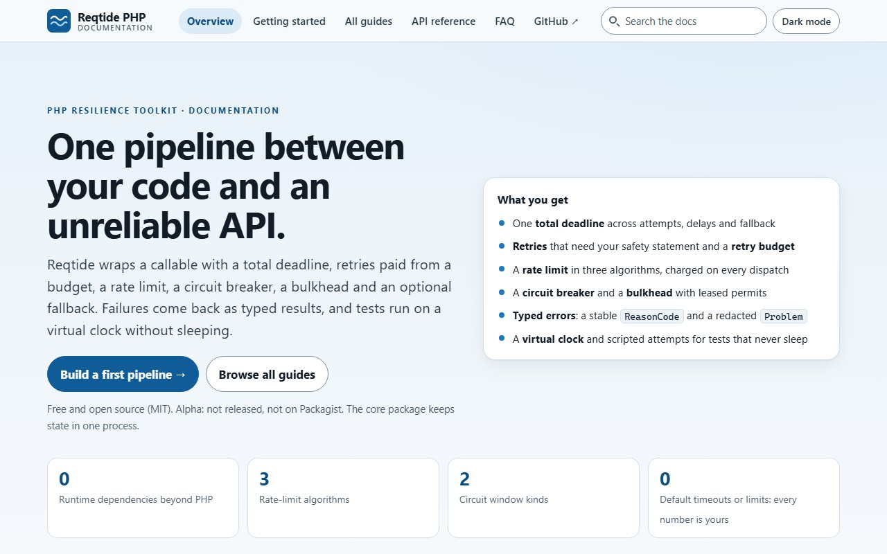

<div align="center" dir="rtl">

[English](../README.md) | **فارسی**

<a href="../docs/index.html"></a>

# Reqtide PHP

**تلاش دوباره، محدودیت نرخ، مدارشکن و مهلت کل در یک خط لوله. قابل آزمون با زمان مجازی.**

جعبه‌ابزار تاب‌آوری برای کد PHP که به APIهای ناپایدار درخواست می‌فرستد.
هستهٔ بسته وابستگی زمان اجرا ندارد. بتا: نسخهٔ 0.x، API ممکن است بین نسخه‌های فرعی عوض شود.

[](../docs/index.html)
[](../examples)

[](../LICENSE)


[](../docs/index.html)

<a href="../docs/index.html"></a>

</div>

<div dir="rtl">

## چرا این بسته ساخته شد

یک حلقهٔ تلاش دوباره اینجا، یک شمارنده آنجا، و یک پرچم که می‌گوید «سرویس از کار افتاده». این‌ها در کد برنامه روی هم جمع می‌شوند و سر اینکه چه کسی اول باید متوقف شود با هم اختلاف دارند. آزمودنشان هم یعنی خوابیدن و منتظر ماندن.

Reqtide این تصمیم‌ها را در یک خط لوله و با ترتیبی ثابت کنار هم می‌گذارد. شما مهلت کل، تلاش دوباره با بودجه، محدودیت نرخ، مدارشکن، bulkhead و در صورت نیاز یک fallback تعیین می‌کنید. خطاها به شکل نتیجه‌های نوع‌دار برمی‌گردند و می‌توانید روی آن‌ها شرط بگذارید. همهٔ عددها با شماست، چون Reqtide مقدار پیش‌فرض ندارد. زمان تزریق می‌شود، پس آزمون backoff نمایی در چند میکروثانیه تمام می‌شود.

Reqtide یک callable را می‌پیچد. کلاینت HTTP، صف یا محافظ لبهٔ شبکه نیست. در بستهٔ هسته، وضعیت در حافظهٔ یک پروسهٔ PHP می‌ماند (بخش [محدودیت‌ها و تضمین‌نشده‌ها](../docs/guides/limits.html) را ببینید).

---

## نصب

| مسیر | وضعیت |
| --- | --- |
| Packagist (`composer require enaxon/reqtide`) | از نسخهٔ 0.1.0 در دسترس است |

```shell
composer require enaxon/reqtide
composer require enaxon/reqtide-redis   # optional: state shared by processes
composer require enaxon/reqtide-guzzle  # optional: Guzzle integration
```

سه بسته با یک شماره نسخه منتشر می‌شوند. هر مبدل دقیقاً همان نسخهٔ هسته را لازم دارد. برای اجرای مثال‌ها بدون PHP روی دستگاه، مخزن را clone کنید و از Docker استفاده کنید: [راهنمای نصب](../docs/guides/install.html).

این کد را در پروژه‌ای که بستهٔ هسته در آن نصب است با نام `demo.php` ذخیره کنید. این همان [`examples/06-getting-started.php`](../examples/06-getting-started.php) است.

```php
<?php

declare(strict_types=1);

namespace Reqtide\Examples\GettingStarted;

use Enaxon\Reqtide\Execution\AttemptContext;
use Enaxon\Reqtide\Execution\OperationSafety;
use Enaxon\Reqtide\Execution\ReplaySafetyContract;
use Enaxon\Reqtide\Outcome\ExceptionClassifier;
use Enaxon\Reqtide\Pipeline\PipelineBuilder;
use Enaxon\Reqtide\Policy\AttemptTimeoutRequirement;
use Enaxon\Reqtide\Policy\BackoffMode;
use Enaxon\Reqtide\Policy\JitterMode;
use Enaxon\Reqtide\Value\Duration;
use Enaxon\Reqtide\Value\Ratio;

require __DIR__ . '/vendor/autoload.php';

/** The failure we treat as transient. Anything else is a plain failure and is never retried. */
final class UpstreamTimeout extends \RuntimeException {}

// Build the pipeline once and reuse it. Every number is yours: Reqtide has no defaults.
$pipeline = PipelineBuilder::profile('payments', 'v1')
    ->partition('shop', 'prod', 'payments-api')
    // One attempt may take at most 2 s (checked by you, not enforced inside your code: "Cooperative").
    ->attemptTimeout(Duration::seconds(2), AttemptTimeoutRequirement::Cooperative)
    // At most 3 attempts in total (the first call counts), exponential backoff from 10 ms up to 100 ms.
    ->retry(3, BackoffMode::Exponential, Duration::milliseconds(10), Duration::milliseconds(100), JitterMode::Full)
    // Retries draw from a budget so a failing dependency is not hammered: 10 tokens, 10 more per minute.
    ->retryBudget(10, 10, Duration::seconds(60), Duration::seconds(10))
    // Token bucket: 5 tokens, refilled 5 per second. Every dispatch, retries included, costs 1 token.
    ->rateLimit(PipelineBuilder::tokenBucket(5, 5, Duration::seconds(1)))
    // Judge the last 10 completed calls; from 4 samples on, open at >= 1/2 failures, for 30 s, then allow 1 probe.
    ->circuitBreaker(PipelineBuilder::lastCalls(10), 4, Ratio::of(1, 2), Duration::seconds(30), 1, 1, Duration::seconds(10))
    // Only UpstreamTimeout may be retried.
    ->compileInMemory(ExceptionClassifier::create()->retryOn(UpstreamTimeout::class));

// The protected call. Here it fails twice with a timeout and then succeeds.
$calls = 0;
$callApi = static function (AttemptContext $attempt) use (&$calls): string {
    ++$calls;
    if ($calls < 3) {
        throw new UpstreamTimeout('upstream timed out');
    }

    return "ok on attempt {$attempt->dispatchedAttemptNumber}";
};

// One context per operation. Its deadline covers all attempts and waits together. forReadOnlyCallable() is YOUR
// statement that running this callable again is safe; Reqtide cannot check it, and refuses to retry without it.
$context = $pipeline->newContext(
    Duration::seconds(30),
    OperationSafety::replayableRead(ReplaySafetyContract::forReadOnlyCallable('get-payment', Duration::seconds(3600))),
);

echo $pipeline->execute($callApi, $context), "\n";
echo "invocations: {$calls}\n";
```

خروجی:

```text-output
ok on attempt 3
invocations: 3
```

`forReadOnlyCallable()` اعلام خود شماست که اجرای دوبارهٔ callable بی‌خطر است. Reqtide هیچ‌وقت حدس نمی‌زند و بدون آن تلاش دوباره نمی‌کند. [شروع سریع](../docs/guides/getting-started.html) هر خط را توضیح می‌دهد.

---

## چه چیزهایی دارد

| قابلیت | چه می‌گیرید |
| --- | --- |
| **مهلت کل** | یک مهلت برای همهٔ تلاش‌ها، تأخیرها و fallback. تلاشی که در مهلت جا نشود شروع نمی‌شود. |
| **تلاش دوباره** | backoff ثابت یا نمایی، jitter اختیاری، `Retry-After` به‌عنوان کف انتظار، و بودجهٔ تلاش دوباره که ترافیک اضافه را سقف می‌گذارد. |
| **محدودیت نرخ** | token bucket، پنجرهٔ ثابت یا شمارندهٔ لغزندهٔ تقریبی، با حساب عدد صحیح. |
| **مدارشکن** | پنجرهٔ تعدادی یا زمانی، حداقل نمونه، پروب در حالت نیمه‌باز. |
| **Bulkhead و cooldown** | سقف همزمانی با lease؛ cooldown مشترک بعد از `Retry-After`. |
| **Fallback** | برای هر عملیات جداگانه روشن می‌شود، برای شکست و در صورت لزوم برای ردشدن. |
| **خطا و رویداد نوع‌دار** | `ReasonCode`، `Problem` پاک‌سازی‌شده (به شکل RFC 9457)، رویدادهای نوع‌دار، `explain()`. |
| **ابزار آزمون** | ساعت مجازی، تلاش‌های اسکریپت‌شده، تصادفی با seed، ضبط‌کنندهٔ رویداد. در همان بسته. |

این‌ها در بستهٔ هسته‌اند. در حافظه اجرا می‌شوند و آزموده شده‌اند. این ادعای آمادگی برای محیط واقعی نیست.

سه بستهٔ Composer با یک نسخه:

| بسته | چه می‌کند | وضعیت |
| --- | --- | --- |
| `enaxon/reqtide` | خط لوله، سیاست‌ها، نتیجه‌های نوع‌دار و ابزار آزمون. بدون وابستگی زمان اجرا. | بتا |
| [`enaxon/reqtide-redis`](../packages/redis/README.md) | محدودیت نرخ، مدارشکن، bulkhead، بودجهٔ تلاش دوباره و cooldown مشترک بین پروسه‌ها، در Redis نسخهٔ ۷٫۰ یا بالاتر. | بتا. روی CLI در PHP 8.3 تا 8.5 و در یک مسیر PHP-FPM آزموده شده. پشتیبانی نمی‌شود: Sentinel، Cluster، Valkey |
| [`enaxon/reqtide-guzzle`](../packages/guzzle/README.md) | `ReqtideClient`: خط لوله دور درخواست‌های Guzzle 7، با قاعده‌های روشن برای اینکه چه چیزی را می‌شود دوبار فرستاد. | بتا. روی CLI در PHP 8.3 تا 8.5 با handlerهای cURL آزموده شده. زیر PHP-FPM آزموده نشده. پشتیبانی نمی‌شود: PSR-18 |

---

## چه کارهایی می‌شود کرد

هر بلوک زیر از یک اسکریپت مخزن آمده و خروجی ضبط‌شدهٔ همان اسکریپت کنارش است.

### قطع تماس با سرویس خراب

چهار تماس شکست می‌خورد و مدار باز می‌شود. تماس پنجم بدون اجرای کد شما رد می‌شود، با یک استثنای نوع‌دار که دلیل قابل‌خواندن برای ماشین دارد (از [`examples/02-failure-demo.php`](../examples/02-failure-demo.php)).

```php
// Judge the last 4 completed calls, but only once 4 samples exist; open when at least half of them failed, stay
// open for 30 s. The permit lease (10 s) must exceed the attempt budget plus 1 s. The default classifier counts
// every exception as a circuit failure and retries none.
$pipeline = $base()
    ->circuitBreaker(PipelineBuilder::lastCalls(4), 4, Ratio::of(1, 2), Duration::seconds(30), 1, 1, Duration::seconds(10))
    ->compileInMemory(ExceptionClassifier::create());

$invocations = 0;
$broken = static function (AttemptContext $attempt) use (&$invocations): string {
    ++$invocations;

    return upstreamIsDown();
};

say('-- circuit breaker');
for ($i = 1; $i <= 4; ++$i) {
    try {
        $pipeline->execute($broken, $context($pipeline));
        check(false, 'a broken callable must not succeed');
    } catch (PermanentError $e) {
        // Closed circuit: your exception comes through untouched.
        say("call {$i}: PermanentError ({$e->getMessage()})");
    }
}
check($invocations === 4, 'the callable ran for each of the four closed-circuit calls');
```

```text-output
-- circuit breaker
call 1: PermanentError (upstream is down)
call 2: PermanentError (upstream is down)
call 3: PermanentError (upstream is down)
call 4: PermanentError (upstream is down)
call 5: Enaxon\Reqtide\Exception\AdmissionRejectedException
```

### آزمون بدون خوابیدن

بستهٔ هسته ساعت مجازی، تلاش‌های اسکریپت‌شده و ضبط‌کنندهٔ رویداد دارد. backoff ۱۰۰ و ۲۰۰ میلی‌ثانیه هیچ زمان واقعی نمی‌گیرد (از [`examples/08-testing.php`](../examples/08-testing.php)).

```php
echo "-- backoff without sleeping\n";
[$pipeline, $clock, $scheduler, $runtime, $events] = rig(false);
$runtime->enqueue(
    DispatchScript::throwing(new UpstreamTimeout('503')),
    DispatchScript::throwing(new UpstreamTimeout('503')),
    DispatchScript::returning('ok'),
);
$start = $clock->peekMonotonic();
$result = $pipeline->execute($unused, context($pipeline, $clock));
$delays = array_map(static fn(Duration $d): int => intdiv($d->nanoseconds, 1_000_000), $scheduler->requestedDelays());

expect($result === 'ok', 'the third dispatch succeeds');
expect($runtime->dispatchCount() === 3, 'exactly three dispatches');
expect($delays === [100, 200], 'exponential backoff waited 100 ms, then 200 ms');
```

```text-output
-- backoff without sleeping
ok: the third dispatch succeeds
ok: exactly three dispatches
ok: exponential backoff waited 100 ms, then 200 ms
```

### اشتراک محدودیت بین پروسه‌ها

با `enaxon/reqtide-redis`، دو خط لوله که جدا ساخته شده‌اند از یک token bucket برداشت می‌کنند. اینجا سه توکن به پنج تماس می‌رسد، هر کس بخواهد (از [`packages/redis/examples/01-shared-rate-limit.php`](../packages/redis/examples/01-shared-rate-limit.php)؛ `tools/run-redis-examples.sh` یک سرور Redis را در Docker بالا می‌آورد).

```PHP
/** What each "process" does: build the same pipeline on the Redis environment. */
$build = static function () use ($registry) {
    $builder = PipelineBuilder::profile('shared-limit', 'v1')
        ->partition('example', 'local', 'reports-api')
        ->attemptTimeout(Duration::seconds(2), AttemptTimeoutRequirement::Cooperative)
        // Three tokens, one refilled per hour: three calls for the life of this script, across both pipelines.
        ->rateLimit(PipelineBuilder::tokenBucket(3, 1, Duration::seconds(3600)));

    return $builder->compile(RedisEnvironment::for($builder->definition(), ExceptionClassifier::create(), connection(), $registry));
};

$pipelines = ['A' => $build(), 'B' => $build()];
$sequence = ['A', 'B', 'A', 'B', 'A'];
```

```console
call 1 via A: served
call 2 via B: served
call 3 via A: served
call 4 via B: refused (rate.exhausted)
call 5 via A: refused (rate.exhausted)
served by A: 2, served by B: 1
```

اگر Redis از کار افتاده باشد، تماس اجرا نمی‌شود و `StateUnavailableException` می‌گیرید.

### محافظت از درخواست‌های Guzzle

با `enaxon/reqtide-guzzle` شما اعلام می‌کنید کدام درخواست‌ها را می‌شود دوبار فرستاد. وضعیت 503 یک پاسخ است: بعد از آخرین تلاش همان را پس می‌گیرید. سرور اینجا سرور آزمون محلی مخزن است (از [`packages/guzzle/examples/01-read-with-retry.php`](../packages/guzzle/examples/01-read-with-retry.php)).

```PHP
$client = ReqtideClient::inMemory(
    PipelineBuilder::profile('orders-api', 'v1')
        ->partition('shop', 'prod', 'orders-api')
        // The transport enforces this timeout on every attempt.
        ->attemptTimeout(Duration::seconds(2), AttemptTimeoutRequirement::TransportEnforced)
        // Up to three attempts, 20 ms apart, and a budget so that a failing server is not hammered.
        ->retry(3, BackoffMode::Constant, Duration::milliseconds(20), Duration::seconds(1), JitterMode::None)
        ->retryBudget(10, 10, Duration::seconds(60), Duration::seconds(12)),
);

$read = static fn(string $path): HttpOperation => HttpOperation::read(
    new Request('GET', $server->baseUri . $path),
    'orders.read',
    Duration::seconds(60),
    HttpOutcomeClassifier::starter()->retryableOutcomeCodes(),
);

$response = $client->send($read('/status/503'), Duration::seconds(10));
echo 'failing server: status ', $response->getStatusCode(), ', requests at the server: ', $server->count('/status/503'), "\n";
```

```console
failing server: status 503, requests at the server: 3
```

---

## راهنمای کامل

راهنما یک سایت ایستا در [`docs/`](../docs/README.md) است: ۱۵ صفحه، جست‌وجو، پوستهٔ روشن و تیره، بدون مرحلهٔ ساخت. فایل `docs/index.html` را در مرورگر باز کنید. راهنما فقط انگلیسی است.

| موضوع | بخوانید |
|---|---|
| شروع | [نصب](../docs/guides/install.html) · [شروع سریع](../docs/guides/getting-started.html) |
| مفاهیم | [مفاهیم](../docs/guides/concepts.html) · [انتخاب سیاست‌ها](../docs/guides/choosing-policies.html) |
| محافظت‌ها | [تلاش دوباره](../docs/guides/retry-and-budget.html) · [محدودیت نرخ](../docs/guides/rate-limiting.html) · [مدارشکن](../docs/guides/circuit-breaker.html) · [Bulkhead و cooldown](../docs/guides/bulkhead-and-cooldown.html) · [Fallback](../docs/guides/fallback.html) |
| خطا و آزمون | [مدیریت خطا](../docs/guides/error-handling.html) · [آزمون](../docs/guides/testing.html) |
| مرجع | [مرجع API](../docs/guides/api-reference.html) · [محدودیت‌ها](../docs/guides/limits.html) · [مقایسه](../docs/guides/comparison.html) · [پرسش‌های متداول](../docs/guides/faq.html) |

---

## وقتی چیزی خراب می‌شود

استثناهای خود شما بدون پوشش بیرون می‌آیند. تصمیم Reqtide، مثل ردشدن، یک استثنای نوع‌دار است با کد دلیل پایدار و یک `Problem` که می‌توانید ثبت یا برگردانید (از [`examples/07-error-handling.php`](../examples/07-error-handling.php)).

```php
// 3. Your own exceptions are never wrapped. They come out exactly as your callable threw them.
$failing = $base()->compileInMemory(ExceptionClassifier::create());
try {
    $failing->execute(static fn(): string => throw new UpstreamTimeout('upstream timed out'), $failing->newContext(Duration::seconds(30)));
} catch (UpstreamTimeout $e) {
    echo 'business exception: ', $e::class, ' (', $e->getMessage(), ")\n";
}
```

```text-output
business exception: Reqtide\Examples\ErrorHandling\UpstreamTimeout (upstream timed out)
```

روی `ReasonCode` و `retryability` شرط بگذارید، نه روی متن پیام. [مدیریت خطا](../docs/guides/error-handling.html) را ببینید.

---

## چه چیزهایی را بررسی کرده‌ایم

این‌ها اجراهای محلی در کانتینر Docker و از خط فرمان هستند.

- **هسته.** آزمون‌های واحد، تحلیل ایستا در بالاترین سطح PHPStan و استاندارد کدنویسی روی PHP 8.3 و 8.4 و 8.5 قبول می‌شوند.
- **مثال‌ها و مستندات.** هر مثال اجرا می‌شود و خروجی‌اش با یک فایل ضبط‌شده مقایسه می‌شود. هر بلوک کد و خروجی در این README و در `docs/` با همان فایل‌ها سنجیده می‌شود.
- **بستهٔ Redis.** مجموعه‌های آزمون روی Redis 7.4.11 و 8.2.10 اجرا می‌شوند، با TLS و با ساعت قابل‌کنترل سرور.
- **بستهٔ Guzzle.** Guzzle 7.15.5 با handlerهای cURL. سناریوهای چندپروسه‌ای و خطا با شمارش درخواست‌هایی که سرور آزمون می‌بیند سنجیده می‌شوند. در همهٔ خروجی‌های بسته دنبال رمزهای تصادفی گشته‌ایم و موردی پیدا نشد.

### خوب است بدانید

- نسخهٔ 0.x بتا است. API ممکن است بین نسخه‌های فرعی عوض شود و هر تغییر در changelog می‌آید. CI با هر push اجرا می‌شود (GitHub Actions: PHP 8.3 و 8.4 و 8.5، مجموعه‌های Redis، مسیر PHP-FPM، پوشش و آزمون جهش)؛ نتایج در برگهٔ Actions مخزن است.
- PHP-FPM یک مسیر در CI دارد (PHP 8.4، nginx، شش worker، Redis 8.2.10). آزمون نشده: کلاینت Guzzle زیر FPM، نسخه‌های دیگر PHP زیر FPM، Apache و وب‌سرورهای دیگر. پشتیبانی نمی‌شود: Redis Sentinel، Redis Cluster، Valkey، Guzzle 8 و PSR-18.
- بستهٔ هسته وضعیت را در یک پروسه نگه می‌دارد. زیر PHP-FPM هر درخواست از صفر شروع می‌کند.
- callback در حال اجرا قطع نمی‌شود. مهلت بین گام‌ها بررسی می‌شود.
- اجرای دقیقاً یک‌بار وجود ندارد، و اگر تماسی پیش از ارسال لغو شود، واحد نرخ مصرف‌شده برگردانده نمی‌شود.
- پروژه بازبینی امنیتی مستقل نداشته است.

فهرست کامل در [محدودیت‌ها و تضمین‌نشده‌ها](../docs/guides/limits.html) است.

---

## نیازمندی‌ها

- PHP نسخهٔ **۸٫۳** یا بالاتر، ۶۴ بیتی (روی ۸٫۳ و ۸٫۴ و ۸٫۵ از خط فرمان آزموده شده). Composer 2.
- بستهٔ هسته هیچ بستهٔ اجباری Composer ندارد.
- `enaxon/reqtide-redis` به `predis/predis` نسخهٔ 3.7، `ext-openssl` و سرور Redis نسخهٔ ۷٫۰ یا بالاتر با `maxmemory-policy noeviction` نیاز دارد.
- `enaxon/reqtide-guzzle` به `guzzlehttp/guzzle` نسخهٔ 7.15.5 یا 7.x بالاتر و `ext-curl` نیاز دارد.

---

## پرسش‌های متداول

<details>
<summary><b>روی Packagist هست؟</b></summary>

بله: `composer require enaxon/reqtide`. [نصب](../docs/guides/install.html) را ببینید.
</details>

<details>
<summary><b>درخواست POST را دوباره می‌فرستد؟</b></summary>

فقط اگر شما بگویید تکرار تماس بی‌خطر است، بودجهٔ تلاش دوباره وجود داشته باشد و کلاس استثنا در فهرست باشد.
</details>

---

## مشارکت

گزارش باگ، اصلاح مستندات و pull requestهای کوچک خوش‌آمد است. اول [CONTRIBUTING.md](CONTRIBUTING.md) را بخوانید. روش کار با Docker و استاندارد کدنویسی در آن آمده است.

- **باگ را گزارش کنید.** از فرم باگ استفاده کنید و یک اسکریپت کوتاه که مشکل را نشان می‌دهد بگذارید.
- **کمک بخواهید.** [SUPPORT.md](SUPPORT.md) را ببینید.

آسیب‌پذیری را به‌صورت خصوصی گزارش کنید: [SECURITY.md](SECURITY.md). لطفاً [آیین‌نامهٔ رفتار](CODE_OF_CONDUCT.md) را رعایت کنید.

### مشارکت‌کنندگان

از همهٔ کسانی که کمک کرده‌اند ممنونیم. نام شما بعد از اولین مشارکتِ پذیرفته‌شده اینجا می‌آید.

تغییرات اخیر در [CHANGELOG.md](../CHANGELOG.md) است.

---

## مجوز

[MIT](../LICENSE). حق نشر ۲۰۲۶ احسان عنالو.

## دربارهٔ پروژه

ساختهٔ [احسان عنالو](https://github.com/ehsanenaloo). Reqtide PHP یک جعبه‌ابزار تاب‌آوری برای PHP است: مهلت، تلاش دوباره، محدودیت نرخ، مدارشکن و bulkhead، با پشتیبان Redis و یکپارچگی با Guzzle.

برچسب‌ها: `php` `resilience` `retry` `rate-limit` `circuit-breaker` `bulkhead` `guzzle` `redis` `api` `http`

</div>
